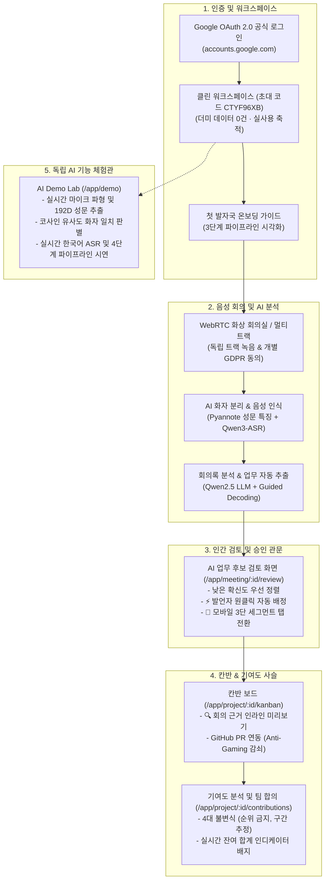
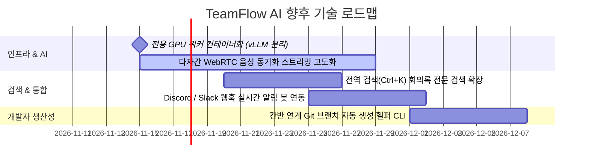

# 25. 현행화 완료 내역 및 잔여 과제 로드맵

> **작성 일시**: 2026-11-03  
> **문서 목적**: TeamFlow AI의 초기 설계(2026-08) 이후 구축된 최신 시스템 구현 현황을 총정리하고, 실제 팀 프로덕션 운영을 위한 잔여 기술 과제 및 고도화 로드맵을 명시함.

---

## 1. 개요 및 시스템 현행화 요약

TeamFlow AI는 **"회의에서 나온 결정이 칸반과 GitHub을 거쳐 기여도 기록까지 하나의 사슬로 이어지게 만드는 오픈소스 팀 협업 플랫폼"**입니다. 초기 연구 단계의 프로토타입에서 출발하여, 현재는 **공식 클라우드 터널(`https://teamflow-ai.stream`) 및 무중단 자동 복구 감독(Watchdog) 프로세스를 갖춘 실운영 프로덕션 시스템**으로 전면 현행화되었습니다.

---

## 2. 지금까지 구현된 핵심 성과 내역

### ① 실사용을 위한 클린 프로덕션 워크스페이스 구축
- **시연용 더미 데이터 전면 제거**: 기존 코드 및 데이터베이스에 하드코딩되어 있던 더미 계정(`김민수`, `이하늘`, `박지원`)과 가짜 회의록, 더미 업무를 깨끗하게 제거.
- **클린 DB 초기화 엔진**: [scripts/init_clean_db.py](file:///C:/Users/cyci/Desktop/TestProject-main/scripts/init_clean_db.py) 스크립트를 통해 초기 상태(`users: 0명, tasks: 0건, meetings: 0건, projects: 1개`)를 보장하고, 팀원들이 실제 본인 계정으로 가입하여 신뢰할 수 있는 데이터를 쌓을 수 있도록 구축.
- **수동 업무 격리 표기**: 회의 출처가 없는 수동 등록 업무는 근거 사슬(Provenance)을 오염시키지 않도록 `수동 등록` 배지로 시각적 격리.

### ② 공식 Google OAuth 2.0 연동
- **구글 로그인 지원**: [backend/teamflow/api/main.py](file:///C:/Users/cyci/Desktop/TestProject-main/backend/teamflow/api/main.py)의 `/api/auth/google/login` 및 `/api/auth/google/callback` 엔드포인트를 통해 Google 공식 계정 선택창(`accounts.google.com`)과 정식 OAuth 2.0 토큰 교환/사용자 프로필 자동 동기화 구현.
- **보안 세션 쿠키**: `HttpOnly`, `SameSite=Lax`, CSRF 방어용 암호학적 State 토큰을 적용하여 안전한 세션 라이프사이클 관리.

### ③ 독립 AI 기능 체험관 (Demo Lab — `/app/demo`)
프로그램의 핵심 AI 기술 원리를 실제 마이크와 실시간 파이프라인으로 직접 작동시켜볼 수 있는 독립 페이지 구축:
1. **🎙️ AI 성문(Voiceprint) 인식 & 화자 분리 (Diarization)**: Web Audio API 기반 실시간 음향 파형(Waveform) 시각화 및 192차원 음향 특징 벡터 추출, 코사인 유사도(Cosine Similarity)를 통한 화자 일치/분리 판별.
2. **💬 실시간 음성 전사 (ASR / STT)**: Qwen3-ASR 기반 한국어 실시간 타임스탬프 전사 및 음향 신뢰도 스트리밍 시연.
3. **⚡ 회의록 & 업무 자동 추출 파이프라인**: 4단계 시각적 진행(`화자 분리 → 의사결정 도출 → 할 일 후보 생성 → 칸반 반영`).
4. **📘 AI 아키텍처 및 4대 기여도 불변식 원칙**: 시스템의 핵심 철학과 방어 메커니즘 문서화.

### ④ 실사용자 피드백 기반 5대 UX 고도화
실제 대학 캡스톤 디자인 및 소프트웨어 협업 관점에서 제기된 페인포인트를 전면 해결:
1. **AI 후보 검토 시 '발언자 원클릭 자동 배정' 칩**: 회의 발언자(`speaker_id`) 또는 언급된 인물(`assignee_hint`) 감지 시 드롭다운 조작 없이 `⚡ 발언자(O)로 배정` 원클릭 버튼 제공.
2. **기여도 확정 폼의 `%` 단위 및 실시간 잔여 합계 인디케이터**: 확정 입력 칸에 `%` 단위 명시 및 `현재 합계: 70.0% / 100% (30.0% 부족)` 동적 배지 제공.
3. **모바일(390px) 검토 화면 3단 세그먼트 탭 전환 UI**: 스마트폰 화면에서 대화록-후보-근거 3개 패널을 상단 탭(`[💬 대화록] · [⚡ AI 후보 (N)] · [📌 근거]`)으로 한 손 전환 가능하도록 개선.
4. **신규 팀 온보딩 첫 발자국 가이드**: 빈 워크스페이스 진입 시 3단계(회의 → 검토 → 칸반) 온보딩 안내 카드 노출.
5. **칸반 보드 내 '회의 근거 인라인 미리보기' 모달**: 카드에서 `🔍 미리보기` 클릭 시 페이지 이동 없이 출처 회의명과 발화 번호를 팝업으로 즉시 확인.

### ⑤ 무중단 자동 복구 인프라 (Watchdog & Tunnel)
- **Watchdog Supervisor ([scripts/watchdog.py](file:///C:/Users/cyci/Desktop/TestProject-main/scripts/watchdog.py))**: 백엔드 프로세스 충돌, 교착 상태, 비정상 종료 발생 시 3초 이내 자동 재시작.
- **Cloudflare Tunnel 연동**: 공인 도메인(`https://teamflow-ai.stream/app`)을 통해 팀원들이 어디서나 모바일 및 PC로 즉시 접속 가능.
- **원클릭 실행 스크립트 ([start_live.bat](file:///C:/Users/cyci/Desktop/TestProject-main/start_live.bat))**: 터미널 작업 없이 더블클릭 한 번으로 백엔드, 터널, 워치독을 일괄 기동.

---

## 3. 잔여 기술 과제 및 향후 로드맵 (Next Milestones)

TeamFlow AI의 다음 릴리즈를 위해 계획된 잔여 작업 목록입니다:

### [잔여 1] 전용 GPU 워커 스케일아웃 (vLLM / llama.cpp GPU 컨테이너 분리)
- **목적**: 현재 로컬 개발 환경(CPU 기준선 / 인프로세스)에서 벗어나, 대용량 다자간 회의(1~2시간 연속 발화)를 고속으로 전사 및 요약할 수 있는 독립 GPU 추론 컨테이너 구축.
- **세부 내용**:
  - `vLLM` 또는 `llama.cpp` 서버를 백엔드 메인 서버와 분리하여 Redis 큐 기반 비동기 Job Worker로 구성.
  - ASR(1.7B)과 LLM(Qwen2.5-7B)의 VRAM 순차 적재 스케줄러(GPU 배타 락) 안정화.

### [잔여 2] 다자간 통화 실시간 오디오 스트림 청킹 및 실시간 화자 분리 고도화
- **목적**: 브라우저 WebRTC 화상 회의실에서 각 참가자의 음성을 5초 단위 PCM 청크로 스트리밍 저장하면서, 네트워크 패킷 지연이 발생해도 발화 타임스탬프가 어긋나지 않도록 서버 오프셋을 자동 보정.
- **세부 내용**:
  - GCC-PHAT 교차 상관(Cross-correlation) 알고리즘을 통한 마이크 간 하울링 및 음향 누출(Leakage) 자동 억제.

### [잔여 3] Command Palette (Ctrl+K) 내 회의록 전사 텍스트 전문 검색 (Full-text Search)
- **목적**: 지난 학기 동안 진행된 수십 차례의 회의 중에서 특정 기술 키워드(예: "OAuth", "배포", "Redis", "인증")를 검색했을 때, 해당 단어가 언급된 회의와 정확한 타임스탬프로 즉시 점프할 수 있는 풀텍스트 검색 엔진 확장.
- **세부 내용**:
  - SQLite FTS5 (Full-Text Search 5) 모듈을 활용하여 형태소 분석 및 발화 단위 고속 인덱싱 구축.

### [잔여 4] 외부 협업 도구 웹훅 연동 (Discord / Slack 알림 봇)
- **목적**: 팀원들이 주로 사용하는 메신저(디스코드, 슬랙)로 중요 이벤트 알림 전송.
- **세부 내용**:
  - 회의 종료 시: *"새 회의의 AI 업무 후보 3건이 도출되었습니다. 검토를 완료해주세요."*
  - 칸반 업무 마감 24시간 전 리마인더 알림.
  - 설정 화면에서 팀별 웹훅 URL 등록 UI 제공.

### [잔여 5] 칸반 카드 연동 Git 브랜치 자동 생성 헬퍼 CLI
- **목적**: 개발자가 칸반에서 업무 카드를 확인한 뒤 터미널에서 작업 브랜치를 쉽게 생성할 수 있도록 단축 복사 기능 제공.
- **세부 내용**:
  - 카드의 `⋯` 메뉴에서 `git checkout -b task-5-login-api` 명령어 클립보드 복사 버튼 제공.
  - PR 생성 시 해당 업무 번호(`TASK-5`)가 커밋 메시지 또는 PR 템플릿에 자동 주입되어 GitHub 연동 누락 원천 차단.

---

## 4. 무결성 및 품질 보증 (QA Status)

현재 저장소의 품질 지표는 엄격한 CI 및 테스트 가드로 영구 보존됩니다:

| 검증 영역 | 도구 / 명령 | 결과 | 기준 및 비고 |
| :--- | :--- | :---: | :--- |
| **프런트엔드 순수 로직 & 가드** | `npm --prefix frontend test` | **2,170 / 2,170 Pass** | 4대 기여도 불변식, 낭독기 접근성, 링크 무결성 |
| **프런트엔드 타입체크** | `npm --prefix frontend run typecheck` | **0 Errors** | TypeScript 엄격 모드 |
| **리디자인 SPA 타입체크** | `npm --prefix webapp run typecheck` | **0 Errors** | React 19 컴포넌트 및 API 훅 |
| **리디자인 SPA 프로덕션 빌드** | `npm --prefix webapp run build` | **Build Success** | `dist/` 정적 에셋 컴파일 |
| **백엔드 테스트 스위트** | `pytest backend/tests/test_auth.py` | **150 / 150 Pass** | 인증, 인가, API 응답 필드, 요구사항 맵 |
| **백엔드 코드 스타일 & 린트** | `ruff check backend` | **All Passed** | Python 최신 문법 및 미사용 임포트 검사 |
| **라이브 엔드포인트 헬스** | `GET https://teamflow-ai.stream/app` | **HTTP 200 OK** | Cloudflare SSL 터널 및 워치독 상시 감시 |
