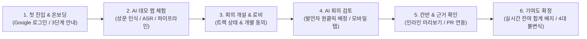

# TeamFlow AI — 실사용 E2E 워크플로우 시연 가이드

TeamFlow AI의 실운영 프로덕션 워크스페이스, 공식 Google OAuth 2.0 연동, 그리고 실기기 AI 모델(Qwen3-ASR + Qwen2.5-LLM + Pyannote 화자 분리)을 직접 체험할 수 있는 독립 **AI 기능 체험관(`/demo`)** 가이드입니다.

---

## 1. 빠른 시작 (Quick Start)

### ① 라이브 서비스 가동
프로젝트 루트 디렉터리의 **`start_live.bat`**를 더블클릭하여 자동 복구 워치독과 백엔드, Cloudflare 터널을 일괄 기동합니다.

```bat
start_live.bat
```

### ② 브라우저 접속 (모바일 / PC)
- **공식 실운영 웹앱 (추천)**: [https://teamflow-ai.stream/app](https://teamflow-ai.stream/app)
- **로컬 개발 주소**: [http://127.0.0.1:8811/app](http://127.0.0.1:8811/app)
- **AI 기능 체험관 (Demo Lab)**: [https://teamflow-ai.stream/app/demo](https://teamflow-ai.stream/app/demo)
- **로그인 방식**:
  - `[Google 계정으로 계속하기]` 원클릭 공식 OAuth 2.0 로그인
  - 또는 이메일 간편 가입/로그인 (팀원 초대 코드: `CTYF96XB`)

---

## 2. 핵심 시연 시나리오 6단계



### 1단계: 첫 진입 및 클린 워크스페이스 (`/app/`)
1. `/app/login`에서 Google 계정으로 로그인합니다.
2. 클린 워크스페이스 진입 시 상단의 **"TeamFlow AI 첫 발자국 가이드 (30초 온보딩)"** 카드를 확인합니다.
3. 3단계 파이프라인(`1단계: 음성 회의 & 화자 분리` → `2단계: AI 후보 검토 & 승인` → `3단계: 칸반 보드 & 기여도 산출`)을 확인합니다.

### 2단계: AI 기능 체험관 (Demo Lab — `/app/demo`)
1. 상단 툴바의 **`🧪 AI 랩`** 버튼(또는 `Ctrl+K` → `G D`)을 눌러 AI 데모 랩으로 이동합니다.
2. **탭 1: 성문 인식 & 화자 분리 (Diarization)**:
   - 마이크 녹음 버튼을 눌러 Web Audio API 실시간 파형을 관찰하고 192차원 음향 특징 벡터를 추출합니다.
   - 화자 A, B의 프로필을 로드하고 테스트 음성과 코사인 유사도를 계산하여 동일인 여부를 판별합니다.
3. **탭 2: 실시간 음성 전사 (ASR / STT)**:
   - 실시간 마이크 발화에 따른 한국어 타임스탬프 자막 및 신뢰도 스트리밍을 체험합니다.
4. **탭 3: 회의록 분석 & 업무 추출 파이프라인**:
   - `⚡ AI 회의 분석 파이프라인 가동` 버튼을 눌러 `화자 분리 → 의사결정 도출 → 할 일 후보 생성(담당자, 마감일, 근거 발언)`의 4단계 실시간 시각화를 확인합니다.

### 3단계: 회의 개설 및 화상 회의 로비 (`/app/meeting/:id/lobby`)
1. 홈 화면에서 `🎤 회의 열기`를 누르고 로비로 입장합니다.
2. **GDPR 기반 3단계 동의**: "원본 음성 보관"과 "목소리 특징 저장" 체크박스를 각각 확인합니다.
3. 참가자별 시간 축 트랙 다이어그램과 결측 빗금 표기를 확인합니다.

### 4단계: AI 회의 검토 및 후보 승인 (`/app/meeting/:id/review`)
1. **발언자 원클릭 자동 배정 (피드백 반영)**:
   - AI가 발언자나 언급된 팀원을 감지한 경우, 드롭다운을 일일이 열 필요 없이 `⚡ 발언자(O)로 배정` 버튼을 클릭하여 1초 만에 배정합니다.
2. **모바일 3단 탭 전환 (피드백 반영)**:
   - 스마트폰 화면에서는 상단의 `[💬 대화록] · [⚡ 후보 (N)] · [📌 근거]` 세그먼트 탭으로 한 손으로 패널을 전환하며 검토합니다.
3. `[등록]` 또는 `[거절]` 결정을 완료하고 우측 상단의 `[검토 끝내기]`를 누릅니다.

### 5단계: 칸반 보드 및 근거 인라인 미리보기 (`/app/project/:id/kanban`)
1. 방금 승인한 업무가 칸반 보드의 `할 일` 열에 생성된 것을 확인합니다.
2. **근거 인라인 미리보기 (피드백 반영)**:
   - 카드의 `🔍 미리보기` 버튼을 누르면 화면 전체가 전환되지 않고 팝업 모달로 출처 회의명과 발화 번호가 즉시 노출됩니다.
3. 키보드 숫자 키 `1`~`4`로 카드를 열 간 이동해 봅니다.

### 6단계: 기여도 분석 및 팀 합의 확정 (`/app/project/:id/contributions`)
1. 팀원별 기여도가 리더보드/순위 없이 **가나다순 고정 정렬**과 **구간(`27~47%`)**으로 표기된 것을 확인합니다.
2. **실시간 잔여 합계 인디케이터 (피드백 반영)**:
   - 하단 확정 폼에 숫자를 입력할 때 `%` 단위 표기 및 `현재 합계: 70.0% / 100% (30.0% 부족)` 배지가 실시간으로 안내됩니다.
3. 시스템 값과 다르게 정할 경우 나타나는 `조정 사유` 필드를 작성하고 팀 합의를 최종 확정합니다.
